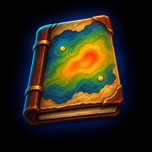

# Fieldnotes

A gathering journal for World of Warcraft **Classic Era** and **Warcraft Forever**. Fieldnotes
remembers everything you gather: every creature you skin, vein you mine, herb you pick, fish you
catch, cloth drop, treasure chest and coin you loot. It notes what each one gave you and exactly
where you stood, then draws it all on your world map, so your best grounds are easy to find.

## Features

- **Heat map on the world map:** a soft glow where you gather most, with numbered hot spots you can
  click for a waypoint, and five color schemes (Thermal, Solar, Frost, Plasma, Viridis). Or switch to
  **Points** (one dot per gather, colored by what it gave) or **Spotlight** (the map dims except where
  you gather).
- **Seven categories,** each with its own tab, hot spots and stats: Skinning, Mining, Herbalism,
  Fishing, Cloth, Treasure and **Money**.
- **Money:** the coin you loot from creatures and chests, including your share in a group. See where
  the money drops, which creatures and chests pay best, and how much you make per hour. In Fieldnotes,
  gold always means money.
- **Home dashboard:** every category in one place, with counts, best zones and skill. On the map,
  every gather is a dot in its category's color; hover one to light its dots.
- **Cloth drop rates:** every humanoid you loot is counted, cloth or not, so you know how often each
  area really drops cloth.
- **Me, Account or Community:** your character, all your characters, or notes shared by other players.
- **Continent and world maps** show a badge on every zone you have notes for.
- **Session window:** one clock for everything you gather, with counts, per hour, skill gained, money
  looted and a heads-up when you need a trainer. Going AFK pauses it, and coming back resumes it. End
  a session for a full recap, with Undo. Resize it, fold it to one line, fade its background, or have
  it open upward.
- **Stats:** charts of your gathering by category, zone, day and hour, your top loot, and each
  category's own details.
- **Share your notes:** one line of text for a zone or everything, to paste in Discord or a friend's
  Import box. No character names, realms or times of day are ever shared.

## Getting started

Open your world map. On Classic Era, click the small Fieldnotes button in the map's top-right
corner; on Warcraft Forever, click the Fieldnotes tab on the map's edge. The panel opens beside the
map. Then go gathering: your notes start with your first skin, vein, herb, catch or loot.

- `/fn` opens your stats
- `/fn share` and `/fn import` share notes
- `/fn tracker` turns the session window on or off
- `/fn chat` turns the chat line for each gather on or off

## Roadmap

See [ROADMAP.md](ROADMAP.md). Found a bug or have an idea? Open an issue on
[GitHub](https://github.com/karl-neiswender/Fieldnotes/issues).
